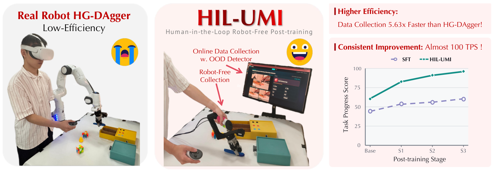
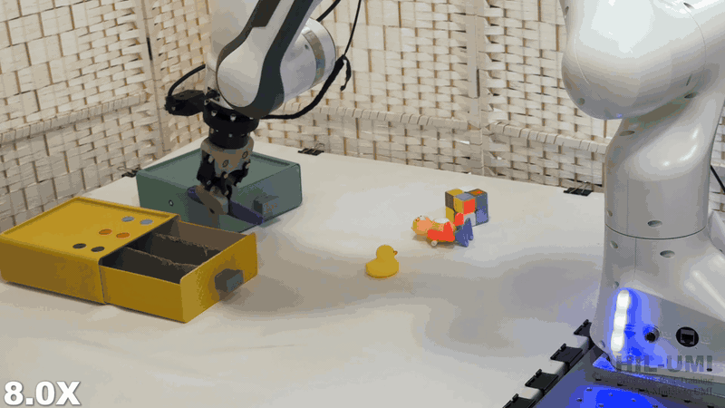
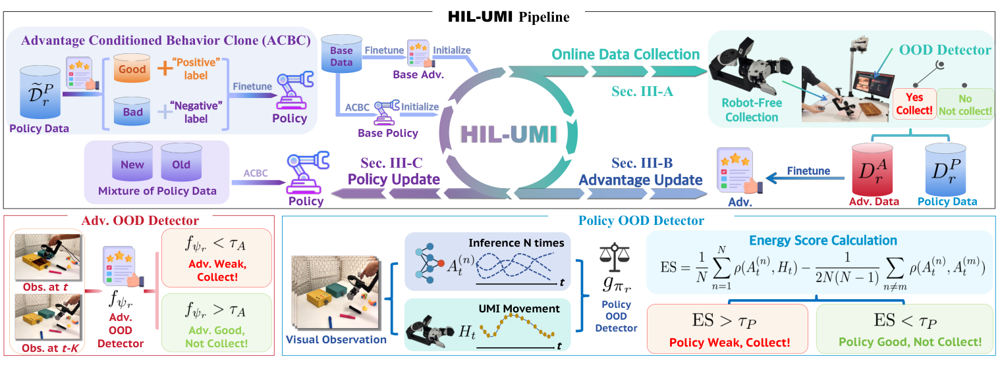

<h1 align="center">HIL-UMI</h1>

<h3 align="center">
  Bringing Human-in-the-Loop Post-Training of<br>
  Vision-Language-Action Models to Universal Manipulation Interface
</h3>

<p align="center">
  Zimu Han<sup>*1,4</sup> &nbsp;·&nbsp;
  Yiming Zeng<sup>*1,4</sup> &nbsp;·&nbsp;
  Jiyao Zhang<sup>*‡1,2,3</sup> &nbsp;·&nbsp;
  Zihao Zhao<sup>1</sup> &nbsp;·&nbsp;
  Yuanfei Wang<sup>1,2,3</sup> &nbsp;·&nbsp;
  Yixiang Jin<sup>5</sup><br>
  Shiqi Li<sup>5</sup> &nbsp;·&nbsp;
  Shuangben Chen<sup>1</sup> &nbsp;·&nbsp;
  Wei Huang<sup>1</sup> &nbsp;·&nbsp;
  Ruodai Li<sup>5</sup> &nbsp;·&nbsp;
  Hui Shen<sup>5</sup> &nbsp;·&nbsp;
  Hao Dong<sup>†1,2,3</sup>
</p>

<p align="center">
  <sub>
    <sup>1</sup> Center on Frontier Computing Studies, School of Computer Science, Peking University<br>
    <sup>2</sup> National Key Laboratory for Multimedia Information Processing, School of Computer Science, Peking University<br>
    <sup>3</sup> PrimeBot &nbsp;·&nbsp; <sup>4</sup> Xi’an Jiaotong University &nbsp;·&nbsp; <sup>5</sup> JD Technology<br>
    <sup>*</sup> Equal contribution &nbsp; <sup>‡</sup> Project lead &nbsp; <sup>†</sup> Corresponding author
  </sub>
</p>

<p align="center">
  <a href="https://hil-umi.github.io/"></a>
  <a href="https://arxiv.org/pdf/2609.20659"></a>
  <a href="#video"></a>
  <a href="#citation"></a>
</p>

<p align="center"><a href="README.md">English</a> &nbsp;|&nbsp; 简体中文</p>

<p align="center"><strong>通过无需机器人参与的数据采集，实现视觉语言动作模型的人在回路后训练。</strong></p>

<!-- Figure 1 from the HIL-UMI paper (arXiv:2609.20659v2). -->
<p align="center">
  <a href="https://arxiv.org/pdf/2609.20659">
    
  </a>
</p>

<p align="center">
  <sub>策略引导的 UMI 采集持续提升任务表现；在 Clean Up Table 任务中，数据采集速度为 HG-DAgger 的 5.63 倍。</sub>
</p>

---

## 项目概览

HIL-UMI 在操作者使用手持 Universal Manipulation Interface（UMI）示范任务时查询当前策略，
通过在线反馈定位用于策略改进和 Advantage 优化的片段，将数据采集与视觉语言动作模型（VLA）的迭代后训练连接起来。

本仓库包含对应的 π₀.₅ 训练、Advantage 估计与标注、采集适配器，以及单臂 Franka 评估代码。

<p align="center">
  <a href="#video">讲解视频</a> &nbsp;·&nbsp;
  <a href="#method">方法流程</a> &nbsp;·&nbsp;
  <a href="#安装">安装</a> &nbsp;·&nbsp;
  <a href="#采集一轮并迭代更新">迭代流程</a> &nbsp;·&nbsp;
  <a href="#citation">引用</a>
</p>

<a id="video"></a>

## 讲解视频

动态预览先播放 Clean Up Table 任务的成功执行片段，再展示与 HG-DAgger 的结果对比。点击可查看完整讲解视频。

<p align="center">
  <a href="docs/assets/hil-umi.mp4?raw=1">
    
  </a>
</p>

<p align="center">
  <a href="docs/assets/hil-umi.mp4?raw=1"><strong>▶ 观看 / 下载完整视频</strong></a> &nbsp;·&nbsp; 3 分钟
</p>

<a id="method"></a>

## 方法流程

<!-- Figure 2 from the HIL-UMI paper (arXiv:2609.20659v2). -->
<p align="center">
  <a href="docs/assets/method.png">
    
  </a>
</p>

每轮后训练包含四个步骤：

1. **采集 Advantage 数据。** 根据在线 Advantage 的低预测值定位片段，收集用于改进进度估计的数据。
2. **采集策略数据。** 使用 Energy Score 比较人类示范与当前策略的动作分布，识别 OOD 片段。
3. **更新估计器。** 用新增数据优化 Advantage 估计器，再为策略训练示范生成优势标签。
4. **更新策略。** 均衡混合基础示范与新增策略数据，继续进行优势条件行为克隆（ACBC）。

---

## 准备条件

- 模型训练和推理使用 Linux/CUDA 主机，准备 Git、`uv` 及依赖清单需要的构建工具。
  CPU 检查可以单独运行。
- 按提供方许可自行获取任务数据、预训练 π₀.₅ 权重和 tokenizer 资源。本源码发布
  **不包含** HIL-UMI 数据集、checkpoint，也不提供数据或模型下载服务。
- 用户需自行准备一套 UMI 数据采集系统，包括配套硬件和软件。
- 真机评估需要已标定的单臂 Franka、相机、ROS Noetic、libfranka/控制器及对应硬件 SDK。


## 安装

使用下表中名称明确的独立环境，模型与机器人环境路径均相对于仓库根目录。策略与
Advantage 保持各自的依赖锁和 Transformers 集成补丁。

| 用途 | 环境 | Python 导入名 | 解释器选择变量 |
| --- | --- | --- | --- |
| 策略训练与推理 | `.venv-policy` | `training`、外部 `openpi` | `POLICY_PYTHON` |
| Advantage 训练、标注与监控 | `.venv-advantage` | `hil_umi_advantage` | `ADVANTAGE_PYTHON` |
| Franka 硬件控制 | `.venv-franka` | `training` 机器人运行代码 | `FRANKA_PYTHON` |
| 外部 recorder | 用户提供的外部环境 | 外部 `data_recorder` | `RECORDER_PYTHON` |

`OOD_PYTHON` 会覆盖按模式选择的解释器，通常保持未设置。

```bash
# From the repository root, on the Linux/CUDA training host
export HIL_UMI_ROOT="$(pwd -P)"
bash requirements/install.sh embodied --model openpi --env franka --venv .venv-policy

# Separate robot-control environment; ROS/controllers remain external prerequisites
bash requirements/install.sh franka --venv .venv-franka

# Separate Advantage environment (do not activate the policy environment here)
(cd advantage && UV_PROJECT_ENVIRONMENT="$HIL_UMI_ROOT/.venv-advantage" \
  GIT_LFS_SKIP_SMUDGE=1 uv sync --frozen --group ood)

# Apply the Advantage Transformers patch only in its own environment
export ADVANTAGE_PYTHON="$HIL_UMI_ROOT/.venv-advantage/bin/python"
cp -R "$HIL_UMI_ROOT/advantage/src/hil_umi_advantage/models_pytorch/transformers_replace/." \
  "$("$ADVANTAGE_PYTHON" -c 'import transformers; print(transformers.__path__[0])')/"

# Lightweight collection adapters; the external recorder stays in its own environment
uv pip install --python .venv-policy/bin/python -e ./collection
uv pip install --python .venv-advantage/bin/python -e ./collection
```

模型环境使用 Python 3.11，外部采集程序使用独立的 Python 3.12 环境。
上面的补丁对应 `transformers==4.53.2`，只应用到 Advantage 环境。
复用现有环境时，通过表中的变量指定解释器；回放编码另需系统安装 `ffmpeg`。

## 数据与模型准备

使用本地 LeRobot **v2.1** 数据工作副本。原始 UMI 数据包含 47 维
`observation.state`、30 维 `action`，以及 `cam_left`、`cam_front` 两路视频。
转换器输出单臂 Franka 的 10 维 `state`、`actions`（XYZ、rotation-6D 和夹爪），
以及 `image`、`extra_view_image`。只有前视视频的压缩包不能作为完整训练数据。

```text
dataset/<task>_umi/                         # raw UMI LeRobot v2.1 data
dataset/<task>_franka/                      # converted single-Franka data
advantage/data/<task>/base/origin/           # canonical base demonstrations
advantage/data/<task>/stage1/origin/         # newly collected round-1 data
checkpoints/pi05/base/model.safetensors     # policy initialization
advantage/checkpoints/pi05_base/            # Advantage initialization
checkpoints/advantage/                      # trained Advantage estimators
outputs/checkpoint_offload/                 # policy training states
collection_dataset/                        # recorded correction datasets
```

这些路径是存储示例，对应资源需要自行准备。数据、权重、环境和运行产物不得提交。
保留原始录制数据，在工作副本上标注。毛巾示例首先转换 base 示范：

```bash
source .venv-policy/bin/activate
export PI05_BASE_CKPT="$HIL_UMI_ROOT/checkpoints/pi05/base"
export TASK_PROMPT="fold the towel on the table and put it into the basket"
python toolkits/lerobot/convert_umi_left_to_single_franka.py \
  --src dataset/fold_towel_umi \
  --dst advantage/data/fold_towel/base/origin \
  --prompt "$TASK_PROMPT"
```

## 训练初始 Advantage 估计器

GT 命令会**原地修改** parquet 和元数据。每条 episode 使用一条从首帧 0 到末帧 1
的整段线性进度曲线。其他任务需要自行匹配 prompt 和数据 schema。

```bash
cd "$HIL_UMI_ROOT/advantage"
export ADV_BASE_DATASET="$PWD/data/fold_towel/base/origin"
export ADVANTAGE_PI05_BASE="$PWD/checkpoints/pi05_base"
export ADVANTAGE_CHECKPOINT_ROOT="$HIL_UMI_ROOT/checkpoints"

# Inspect first; omit --dry-run to write annotations to your working copy
UV_PROJECT_ENVIRONMENT="$HIL_UMI_ROOT/.venv-advantage" uv run python scripts/annotate_stage_progress_gt.py \
  --dataset-dir "$ADV_BASE_DATASET" --linear --dry-run
UV_PROJECT_ENVIRONMENT="$HIL_UMI_ROOT/.venv-advantage" uv run python scripts/annotate_stage_progress_gt.py \
  --dataset-dir "$ADV_BASE_DATASET" --linear

CUDA_VISIBLE_DEVICES=0,1 NPROC_PER_NODE=2 \
bash advantage train-base towel_base_v1 \
  --data.repo-id="$ADV_BASE_DATASET" \
  --num-train-steps=5000 --save-interval=1000 --batch-size=64
```

## 标注示范并训练策略

离线标注产生新数据集，不修改输入。策略使用其中的 `task_index` 和 positive/negative prompt.

```bash
cd "$HIL_UMI_ROOT/advantage"
export BASE_ADV_CKPT="$HIL_UMI_ROOT/checkpoints/advantage/ADVANTAGE_TORCH_TOWEL_FOLD/towel_base_v1/5000"
bash scripts/label_advantage_datasets.sh \
  --checkpoint "$BASE_ADV_CKPT" \
  --output-root "$HIL_UMI_ROOT/dataset/fold_towel_acbc" \
  --dataset base="$PWD/data/fold_towel/base/origin" \
  --devices cuda:0,cuda:1 --batch-size 32 \
  --future-frames 50 --top-percent 30

cd "$HIL_UMI_ROOT"
source .venv-policy/bin/activate
export PI05_BASE_CKPT="$HIL_UMI_ROOT/checkpoints/pi05/base"
bash scripts/pi05_acbc.sh dataset/fold_towel_acbc/base fold_towel_acbc 0-1
```

## 采集一轮并迭代更新

将 `collection/config/recorder.example.yaml` 复制为已忽略的
`collection/config/recorder.local.yaml`，在本地文件中配置设备与输出路径。
在 `collection/config/ood.yaml` 中设置策略 checkpoint、归一化统计、任务 prompt 和相机映射；
在 `collection/config/advantage_ood.yaml` 中设置估计器。替换所有硬件占位值。
采集程序需要 OOD 兼容补丁。尚未应用时，可对自行准备的安装包生成补丁副本
（采集环境需安装 `wheel`）：

```bash
RECORDER_PYTHON=/path/to/external-recorder-env/bin/python \
  bash "$HIL_UMI_ROOT/collection/scripts/patch_recorder_for_ood.sh" \
  /path/to/data_recorder-0.1.21-py3-none-any.whl
```

输出位于 `collection/.local/patched-wheels/`，需手动安装到采集环境；输入不会被覆盖。

```bash
cd "$HIL_UMI_ROOT/collection"
export RECORDER_PYTHON=/path/to/external-recorder-env/bin/python
export RECORD_BIN=/path/to/external-recorder-env/bin/record
export POLICY_PYTHON="$HIL_UMI_ROOT/.venv-policy/bin/python"
export ADVANTAGE_PYTHON="$HIL_UMI_ROOT/.venv-advantage/bin/python"
unset OOD_PYTHON
bash run_ood_teleop.sh --mode pi05 config/recorder.local.yaml

# For the separate Advantage collection loop
bash run_ood_teleop.sh --mode advantage config/recorder.local.yaml
```

两条命令分别对应两种采集模式。启动前可加 `--check` 检查配置和依赖，不打开设备或加载模型权重。
监控面板默认为 `http://127.0.0.1:8765`；A 开始、B 保存、X 丢弃、Y 退出。
监控提供反馈，不会在机器人上执行预测，也不会自动给训练 parquet 标注。

每轮采集后：

1. 校验完整录制数据，整理到 `advantage/data/fold_towel/stage1/origin/`。
2. 标注该工作数据，从上一阶段估计器 checkpoint 初始化，以 base 和本轮数据更新 Advantage。
3. 用更新后的估计器重新标注原始 base 示范，并通过现有标注入口准备本轮策略数据。
4. 从上一阶段策略 checkpoint 启动 `scripts/pi05_mix_acbc.sh`，设置混合比例（示例为 0.5/0.5），
   使用相同数据和比例重新计算统计，再转换并评估新策略。

### 采集接口

| 数据 | 接口约定 |
| --- | --- |
| 状态 | Unix 数据报 JSON，包含 `message_type=state`、`sys_ts`、`left_pose`/`right_pose` 的 4×4 位姿、夹爪反馈/命令及录制状态。 |
| 生命周期 | `message_type=lifecycle`，含 `timestamp`、`state`、`episode`、`run_root`，转发录制、保存和丢弃事件；回放以保存完成事件为准。 |
| 图像 | `dr_<camera_name>_rgb` 共享内存，RGB `uint8[H,W,3]`；相机名称、宽高、帧率和 `ring_slots` 必须与采集配置一致。 |

位姿沿用采集器的跟踪坐标系，Advantage 的 `frame_offset` 必须小于 `ring_slots`。
启动器从 `RECORDER_PYTHON` 定位共享内存模块；自定义位置可用 `COLLECTION_RECORDER_RING_MODULE` 指定。

## SFT 基线

原始 UMI 示范的普通 SFT 入口为：

```bash
cd "$HIL_UMI_ROOT"
source .venv-policy/bin/activate
bash scripts/pi05_sft.sh dataset/fold_towel_umi fold_towel \
  "fold the towel on the table and put it into the basket" 0-1
```

该脚本依次转换数据、计算统计，默认训练 20,000 步；可追加 `--max_steps`、`--lr` 等训练参数。
策略训练脚本统一放在 `scripts/`：`pi05_sft.sh` 用于普通 SFT，`pi05_acbc.sh` 用于
Advantage 条件训练，`pi05_mix_acbc.sh` 用于迭代混合训练，`pi05_post-train.sh` 用于普通混合后训练。
它们共同调用 `scripts/run_vla_sft.sh`；常规训练只需提供数据、任务、GPU 等运行参数，
额外参数用于覆盖默认训练设置。

## 转换并部署到 Franka

训练状态中的 `full_weights.pt` 不能直接作为部署模型。请转换其所在的
`global_step_<N>` 目录，并使用**同一次训练**对应的统计。
运行前填写设备变量；普通 SFT 策略应使用不带条件后缀的任务 prompt。

默认策略接口每次返回 20 帧、每帧 10 维的动作：XYZ、6D 旋转和夹爪。部署端将每帧动作
转换为 Franka 末端的绝对目标位姿及独立的夹爪命令。ROS 路径向
`/cartesian_impedance_controller/equilibrium_pose` 发布 `PoseStamped` 目标，
由外部笛卡尔阻抗控制器完成机器人底层控制。

```bash
cd "$HIL_UMI_ROOT"
source .venv-policy/bin/activate
export POLICY_CKPT=/path/to/global_step_5000
export POLICY_STATS=/path/to/matching/norm_stats.json
export DEPLOY_MODEL="$HIL_UMI_ROOT/checkpoints/pi05/fold_towel_deploy"
python -m training.utils.ckpt_convertor.openpi.convert --mode sft2new \
  --ckpt "$POLICY_CKPT" --input-norm-stats "$POLICY_STATS" \
  --output-model "$DEPLOY_MODEL" \
  --output-norm-stats "$DEPLOY_MODEL/norm_stats/norm_stats.json"

export POLICY_PYTHON="$HIL_UMI_ROOT/.venv-policy/bin/python"
export FRANKA_PYTHON="$HIL_UMI_ROOT/.venv-franka/bin/python"
export ROS_NOETIC_SETUP=/opt/ros/noetic/setup.bash
export FRANKA_CATKIN_SETUP=/path/to/franka_ws/devel/setup.bash
bash evaluations/run_umi_left_franka_eval.sh \
  --model_path "$DEPLOY_MODEL" \
  --norm_stats_path "$DEPLOY_MODEL/norm_stats" \
  --robot_ip "$FRANKA_ROBOT_IP" \
  --wrist_camera "$FRANKA_WRIST_CAMERA_SERIAL" \
  --front_camera "$FRANKA_FRONT_CAMERA_SERIAL" \
  --keyboard_device "$TRAINING_KEYBOARD_DEVICE" \
  "env.eval.override_cfg.task_description='fold the towel on the table and put it into the basket, Advantage: positive'"
```

在部署包装器后追加 `--dry-run`，可在无需 ROS、模型或设备的情况下预览命令，且不创建日志。
它只检查路径参数和命令形式，不运行推理。`evaluations/run_eval.sh` 只接受保留的
`realworld` 单臂 Franka 配置。

`POLICY_CKPT`、`POLICY_STATS` 及设备变量均由使用者提供。变更数据混合比例后必须重新
计算统计。部署权重保持原模型张量格式；包改名后不保证旧版完整训练状态能直接恢复。


## 许可

请阅读 [LICENSE](LICENSE)、[Advantage 许可证](advantage/LICENSE)和
[Gemma 条款](advantage/LICENSE_GEMMA.txt)。
数据和模型许可独立于代码许可。

<a id="citation"></a>

## 引用

Zimu Han, etc. *HIL-UMI: Bringing Human-in-the-Loop Post-Training of Vision-Language-Action Models to Universal Manipulation Interface*. arXiv:2609.20659, 2026.

使用 HIL-UMI 时请使用下面的 BibTeX 引用论文。

```bibtex
@article{han2026hilumi,
  title={HIL-UMI: Bringing Human-in-the-Loop Post-Training of Vision-Language-Action Models to Universal Manipulation Interface},
  author={Han, Zimu and Zeng, Yiming and Zhang, Jiyao and Zhao, Zihao and Wang, Yuanfei and Jin, Yixiang and Li, Shiqi and Chen, Shuangben and Huang, Wei and Li, Ruodai and Shen, Hui and Dong, Hao},
  journal={arXiv preprint arXiv:2609.20659},
  year={2026}
}
```
